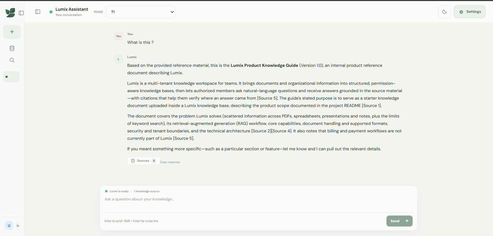
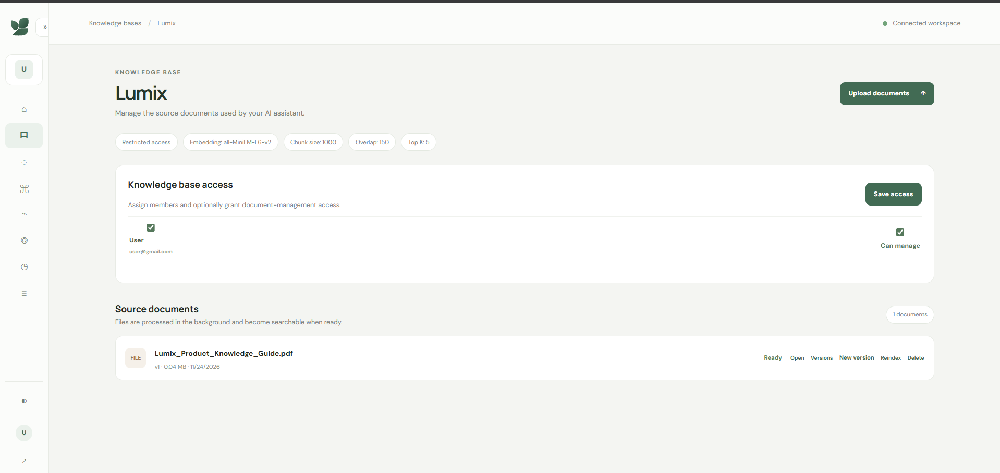
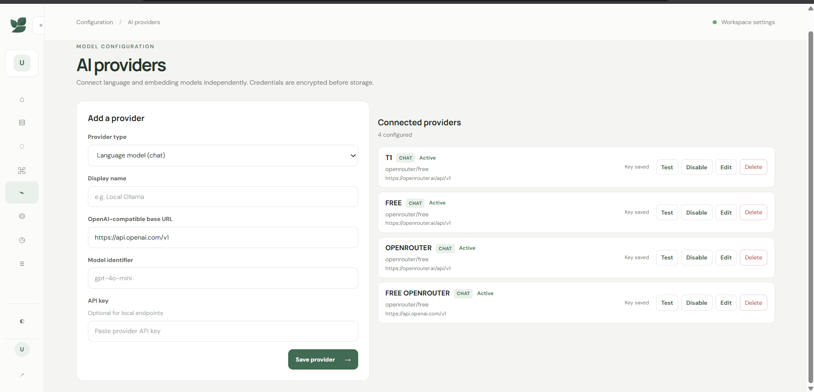
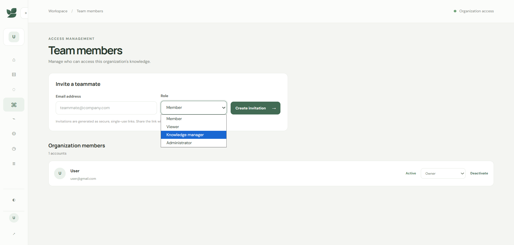
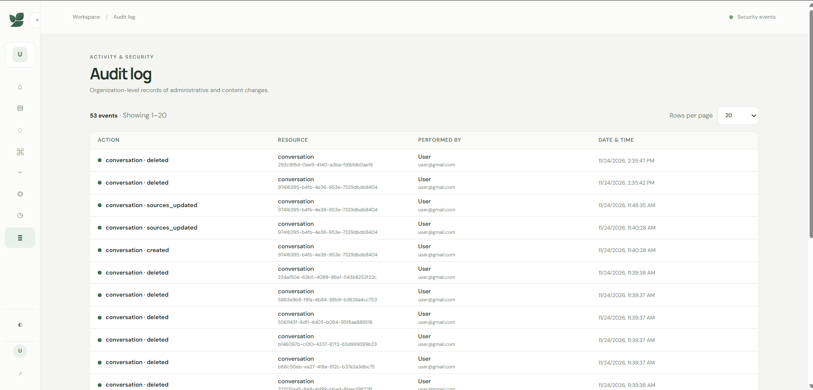
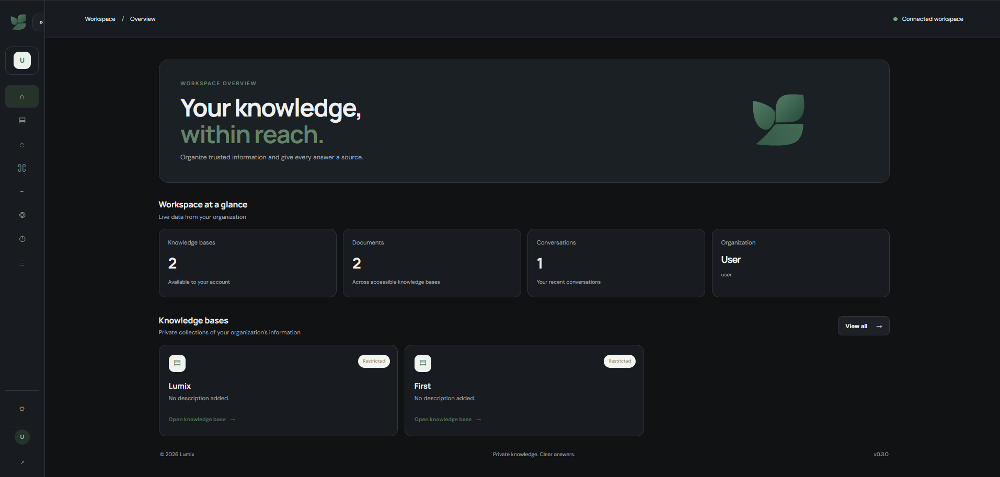
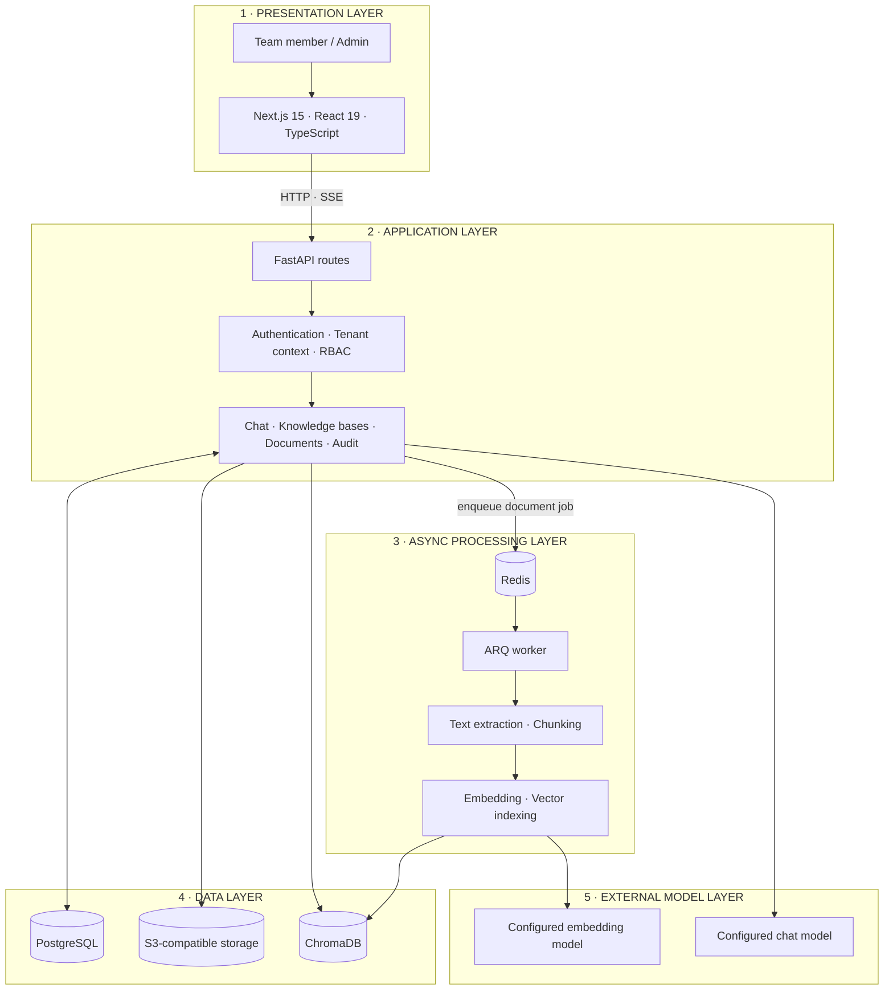
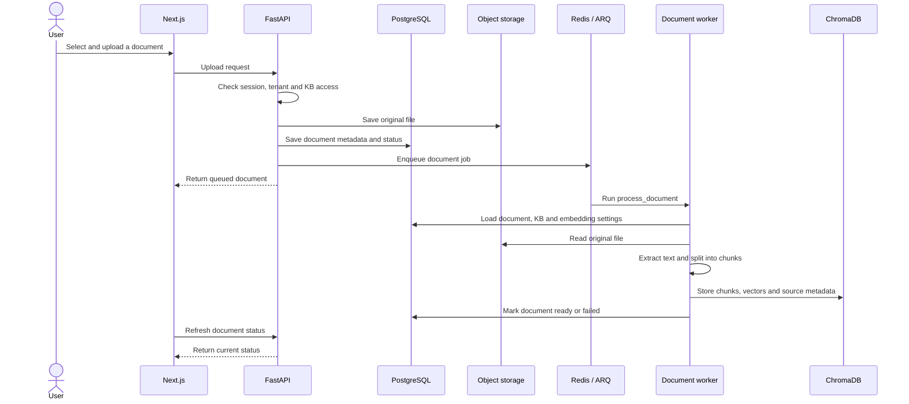
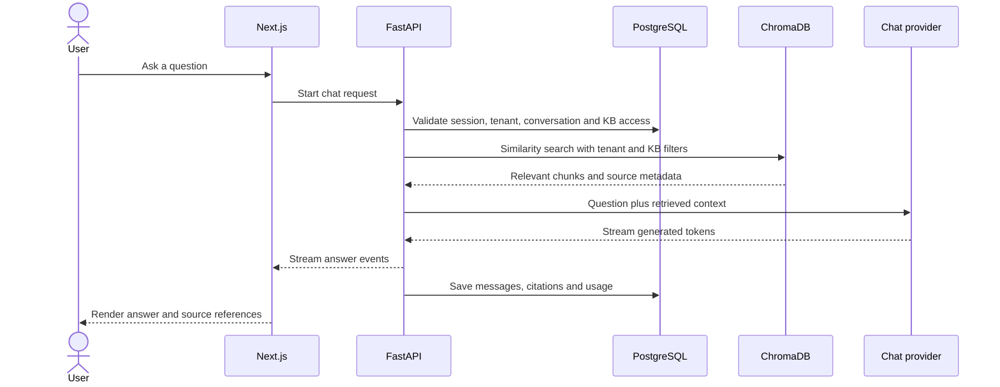

<div align="center">
  
  <h1>Lumix</h1>
  <p><strong>A multi-tenant knowledge workspace with document grounded AI chat.</strong></p>
  <p>Bring team knowledge together, index it in the background, and ask questions with answers linked to their source material.</p>
  <p>
    
    
    
    
    
    
    
    
    
  </p>
  <p>
    <a href="#product-overview">Product overview</a> ·
    <a href="#architecture">Architecture</a> ·
    <a href="#run-locally-with-docker">Run locally</a> ·
    <a href="#development-checks">Development</a>
  </p>
  <br />
  
  <p><sub>Product preview · Chat with answers grounded in your team's knowledge</sub></p>
</div>

---

## Product overview

Lumix is built for teams that need to find answers across their own documents without losing the context of where an answer came from. Members work inside a tenant workspace, organize source material into knowledge bases, and ask questions against the knowledge they are permitted to access.

### Who it is for

- **Internal teams** that need one place to search policies, process documents, technical notes, and team references.
- **Customer success and support teams** that need consistent answers from approved product guides and internal documentation.
- **Engineering teams** that want to query architecture notes, runbooks, API references, and troubleshooting guides.
- **Operations and HR teams** that need staff to find the right procedure or policy without manually searching multiple files.
- **Consulting and project teams** that work across client-specific documents and need workspace-level separation.

These are intended use cases for the current document-and-chat workflow, not claims of a deployed customer base or integrations with external business systems.

### Product areas

| Area | What a member can do |
|---|---|
| Workspaces and access | Register a workspace, invite members, switch workspaces, and manage roles. |
| Knowledge bases | Create collections of knowledge, choose visibility, and control member access. |
| Document management | Upload supported files, follow indexing status, and manage document versions. |
| AI chat | Ask questions against selected knowledge bases and receive streamed, source-linked answers. |
| Model configuration | Configure workspace chat and embedding providers using compatible endpoints. |
| Workspace operations | Review audit history and usage analytics; manage account preferences. |
| Platform administration | Use a separate platform-admin area for platform-level administration. |

**Current scope:** billing, subscriptions, invoices, payment processing, and plan enforcement are not implemented.

## Product screenshots

A quick look at the main product areas. Original captures are in [`screenshots/`](screenshots/).

<table>
  <tr>
    <td align="center" width="50%">
      <strong>Knowledge workspace chat</strong><br />
      
      <sub>Ask questions and inspect supporting sources.</sub>
    </td>
    <td align="center" width="50%">
      <strong>Knowledge bases</strong><br />
      
      <sub>Organize documents and manage access.</sub>
    </td>
  </tr>
  <tr>
    <td align="center">
      <strong>AI provider configuration</strong><br />
      
      <sub>Configure chat and embedding models.</sub>
    </td>
    <td align="center">
      <strong>Team collaboration</strong><br />
      
      <sub>Invite teammates into a workspace.</sub>
    </td>
  </tr>
  <tr>
    <td align="center">
      <strong>Audit history</strong><br />
      
      <sub>Review workspace activity.</sub>
    </td>
    <td align="center">
      <strong>Dark appearance</strong><br />
      
      <sub>Alternative theme across the workspace.</sub>
    </td>
  </tr>
</table>

## Architecture

### System architecture — layered view

The application is split by responsibility. The browser-facing layer handles the user experience, the API layer applies business rules and access checks, the processing layer handles work that should not block a request, and the data/integration layer stores the records and connects to model providers.



| Layer | Responsibility | Main components |
|---|---|---|
| Presentation | Screens, forms, navigation, streaming chat UI | Next.js, React, TypeScript |
| Application | Sessions, tenant isolation, permissions, product workflows, API responses | FastAPI, SQLAlchemy |
| Async processing | File extraction, chunking, embedding, indexing | Redis, ARQ worker |
| Data | Durable records, original files, searchable vectors | PostgreSQL, S3-compatible storage, ChromaDB |
| Model integration | Generate answers and vector embeddings | Workspace-configured model endpoints |

The API and worker share the same application code and database models, but run as separate processes. This keeps upload requests short while indexing runs independently.

### Document ingestion

The original file is stored in object storage. The API records its metadata and queues a job; the worker extracts text, splits it into chunks, creates embeddings, and writes the chunks and metadata to the knowledge base's Chroma collection.



### Chat and retrieval

A chat request is checked against the signed-in user's tenant and knowledge-base permissions. Lumix retrieves relevant chunks, supplies them as context to the selected chat provider, streams the response, and records citations against the source documents.



### Data boundaries

- PostgreSQL is the source of truth for users, tenants, memberships, knowledge bases, documents, conversations, messages, providers, and audit records.
- Original uploaded files live in private S3-compatible object storage.
- ChromaDB stores searchable chunks and their metadata. Collections are derived from the tenant and knowledge-base identifiers.
- Redis is used by ARQ to hand document-processing work from the API to the worker.
- Chat and embedding providers are configured by a workspace. Provider API keys are encrypted before they are stored in PostgreSQL.

## Technology stack

The main stack is shown together here for a quick technical scan.

<div align="center">
  
</div>

**Web:** Next.js 15 App Router · React 19 · TypeScript · Tailwind CSS 4

**Backend:** Python 3.12 · FastAPI · Pydantic Settings · SQLAlchemy 2 async · asyncpg

**Data and processing:** PostgreSQL 16 · Alembic · Redis 7 · ARQ · ChromaDB · S3-compatible object storage · MinIO

**AI and document handling:** LangChain OpenAI integrations · OpenAI-compatible model endpoints · PyMuPDF · python-docx · python-pptx · BeautifulSoup · openpyxl

There is one Python API service. The Next.js application does not have a separate Node.js business API.

## Repository layout

Keep related code in its existing area rather than creating a new abstraction for every small change.

```text
.
├── apps/
│   ├── api/
│   │   ├── app/
│   │   │   ├── api/v1/       # HTTP routes grouped by product area
│   │   │   ├── core/         # Application configuration
│   │   │   ├── main.py       # FastAPI app, middleware and health checks
│   │   │   ├── models.py     # SQLAlchemy models
│   │   │   ├── schemas.py    # API schemas
│   │   │   ├── dependencies.py
│   │   │   ├── security.py   # Password and session security
│   │   │   ├── secrets.py    # Provider-key encryption
│   │   │   ├── storage.py    # S3-compatible file operations
│   │   │   ├── vector_store.py
│   │   │   ├── worker.py     # Extraction and indexing jobs
│   │   │   └── cli.py        # Administrative CLI commands
│   │   ├── migrations/      # Alembic revisions
│   │   ├── tests/
│   │   ├── requirements.txt
│   │   └── Dockerfile
│   └── web/
│       ├── app/              # App Router pages, components and styles
│       ├── public/           # Static assets
│       ├── package.json
│       └── Dockerfile
├── screenshots/
├── .env.example
├── docker-compose.yml
└── README.md
```

### Where to make a change

- Add or change an API endpoint in the relevant file under `apps/api/app/api/v1/`, then register a new router in `router.py` if you add a new module.
- Put shared database entities in `models.py` and request/response validation in `schemas.py`.
- Create an Alembic revision when a database schema changes. Do not edit an already-applied migration to change deployed schema.
- Keep document extraction and indexing work in the worker, not in a long-running API request.
- Put S3 operations in `storage.py` and Chroma collection operations in `vector_store.py`.
- Keep pages and their page-specific UI in the matching route under `apps/web/app/`. Shared UI belongs in `components/`; shared API and auth helpers are in `lib/`.

## Run locally with Docker

Docker Compose starts PostgreSQL, Redis, ChromaDB, MinIO, the API, the worker, and the web app.

### Requirements

- Docker Desktop with Docker Compose
- Git
- A modern browser

### 1. Get the project ready

From the repository root in PowerShell:

```powershell
Copy-Item .env.example .env
```

Open `.env` and replace `SECRET_KEY` and `ENCRYPTION_KEY` with separate, strong values before using the project beyond local experimentation. Keep the encryption key stable and backed up: provider credentials already stored in the database cannot be decrypted if that key is changed.

The Compose file uses development credentials for local PostgreSQL and MinIO. Do not reuse those credentials in a public or production deployment.

### 2. Start the stack

```powershell
docker compose up --build -d
```

Check service status and logs:

```powershell
docker compose ps
docker compose logs -f api worker web
```

### 3. Open the services

| Service | Local address |
|---|---|
| Lumix web app | http://localhost:3000 |
| FastAPI | http://localhost:8000 |
| API docs (development only) | http://localhost:8000/docs |
| API liveness | http://localhost:8000/health/live |
| API readiness | http://localhost:8000/health/ready |
| MinIO console | http://localhost:9001 |

The API container runs `alembic upgrade head` before starting Uvicorn. The worker is a separate process.

### 4. Create a platform administrator

Run this once after the API and database are ready:

```powershell
docker compose exec api python -m app.cli create-super-admin --email admin@example.com --name "Platform Admin"
```

The command prompts for a password (minimum 10 characters). If the email already belongs to a user, it grants that account platform-admin access. Sign in at http://localhost:3000.

A normal workspace can be created from the registration page.

## Run web and API outside Docker

This setup still uses Docker for PostgreSQL, Redis, ChromaDB, and MinIO. It is useful when you want hot reload and direct access to the API or frontend process.

### 1. Start infrastructure

```powershell
docker compose up -d postgres redis chroma minio
```

### 2. Start the API

Use Python 3.12:

```powershell
cd apps/api
python -m venv .venv
.venv\Scripts\Activate.ps1
python -m pip install -r requirements-dev.txt
python -m alembic upgrade head
python -m uvicorn app.main:app --reload --port 8000
```

The API reads the repository-root `.env` file. The example values use the host-mapped ports: PostgreSQL `5644`, Redis `6380`, ChromaDB `8001`, and MinIO `9000`.

In a second terminal, activate the same virtual environment and start the worker:

```powershell
cd apps/api
.venv\Scripts\Activate.ps1
arq app.worker.WorkerSettings
```

### 3. Start the web app

In another terminal:

```powershell
cd apps/web
npm ci
npm run dev
```

The browser-facing API URL is configured by `NEXT_PUBLIC_API_URL`. For local development, use:

```dotenv
NEXT_PUBLIC_API_URL=http://localhost:8000/api/v1
```

## Configuration

Copy `.env.example` to `.env`. These are the settings currently used by the application:

| Variable | Purpose |
|---|---|
| `APP_ENV`, `APP_NAME` | Runtime environment and API name |
| `API_V1_PREFIX` | API route prefix |
| `SECRET_KEY` | Signing secret for application tokens |
| `ENCRYPTION_KEY` | Stable input used to derive the provider-key encryption key |
| `ACCESS_TOKEN_EXPIRE_MINUTES` | Access-token lifetime |
| `REFRESH_TOKEN_EXPIRE_DAYS` | Refresh-session lifetime |
| `CORS_ORIGINS` | Allowed browser origins, as a JSON array |
| `DATABASE_URL` | Async PostgreSQL connection string |
| `DB_POOL_SIZE`, `DB_MAX_OVERFLOW` | SQLAlchemy connection-pool sizing |
| `DB_POOL_TIMEOUT_SECONDS`, `DB_POOL_RECYCLE_SECONDS` | Pool timeout and connection recycle settings |
| `REDIS_URL` | Redis connection string used by ARQ |
| `CHROMA_URL` | ChromaDB HTTP endpoint |
| `S3_ENDPOINT_URL` | S3-compatible storage endpoint |
| `S3_BUCKET` | Bucket for original documents |
| `S3_ACCESS_KEY`, `S3_SECRET_KEY`, `S3_REGION` | Object-storage credentials and region |
| `MAX_UPLOAD_SIZE_MB` | Per-file upload limit |
| `MAX_BATCH_UPLOAD_SIZE_MB` | Combined batch upload limit |
| `NEXT_PUBLIC_API_URL` | API base URL used by the web application |

The Compose file supplies service-to-service connection URLs inside its containers. For local processes running on your machine, use the host-mapped URLs in `.env.example`.

### AI provider setup

1. Sign in and open **Settings → AI providers**.
2. Add a chat provider with its base URL, model, and API key (if required).
3. Add an embedding provider only if you want to use a custom OpenAI-compatible embedding endpoint.
4. Choose the embedding configuration when creating a knowledge base.

The default embedding path uses ChromaDB's configured default embedding function. A knowledge base's embedding model and provider must remain compatible with its existing indexed vectors. If you need to change embedding dimensions or switch embedding models, plan a re-index rather than mixing vectors from different models in one collection.

Provider keys are encrypted before they are saved. If the encryption key is lost or changed, edit the affected provider and enter its key again.

## Document formats and indexing

The worker currently extracts text from:

- PDF
- DOCX and PPTX
- TXT and Markdown
- CSV and XLSX
- HTML
- JSON

PDF extraction keeps page numbers for source references. PowerPoint extraction tracks slide numbers. Other formats are indexed as extracted text without a page number.

The document lifecycle is:

`queued → processing → ready`

A processing error moves the document to `failed` with an error message. The worker retries ARQ jobs up to the configured retry limit. Check worker logs when a document remains queued or fails.

## Security notes

- Passwords are hashed with Argon2.
- Browser sessions use HttpOnly cookies; refresh tokens rotate and sessions can be revoked.
- Tenant-owned data must be queried through the authenticated tenant context.
- Knowledge-base access is enforced for reads, uploads, downloads, and retrieval.
- Provider API keys are encrypted at rest. Do not return them to the browser or log them.
- Original documents are stored in private object storage and downloaded through short-lived signed URLs.
- Provider endpoints are validated; use HTTPS outside recognized local development environments.
- In production, use separate strong values for `SECRET_KEY` and `ENCRYPTION_KEY`, restrict CORS, and replace all local infrastructure credentials.
- Keep PostgreSQL, Redis, ChromaDB, and MinIO private; do not expose their ports publicly.

## Development checks

Run API checks from `apps/api`:

```powershell
python -m pytest -q
python -m compileall app migrations tests
ruff check app migrations tests
```

Run the web checks from `apps/web`:

```powershell
npm run lint
npm run build
```

Apply database migrations from `apps/api`:

```powershell
python -m alembic upgrade head
```

Review migration history:

```powershell
python -m alembic history
python -m alembic current
```

Before committing a schema change, test the migration against a disposable development database. Do not use database reset commands against a database that contains data you need.

## Routine maintenance

| Task | Command or location |
|---|---|
| Follow API logs | `docker compose logs -f api` |
| Follow worker logs | `docker compose logs -f worker` |
| Follow web logs | `docker compose logs -f web` |
| Check service health | `docker compose ps` and `/health/ready` |
| Apply migrations | `cd apps/api; python -m alembic upgrade head` |
| Rebuild after dependency or Dockerfile changes | `docker compose up --build -d` |
| Stop services (keep volumes) | `docker compose down` |
| See persistent volumes | `docker volume ls` |

`docker compose down -v` deletes the Compose-managed data volumes. That removes local database, object-storage, vector-store, and Redis data; do not use it as a routine troubleshooting step.


## Current scope

Lumix is under  development. The repository and migrations are the source of truth for current behavior. This README describes the implemented service boundaries and setup; it does not imply billing, production deployment automation, or end-to-end coverage that is not present in the codebase.
